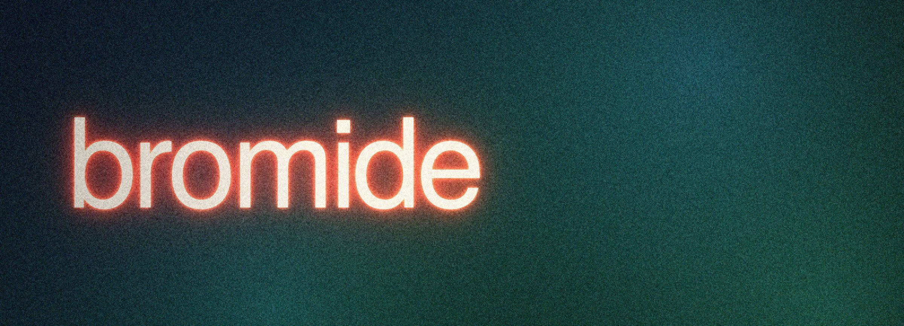
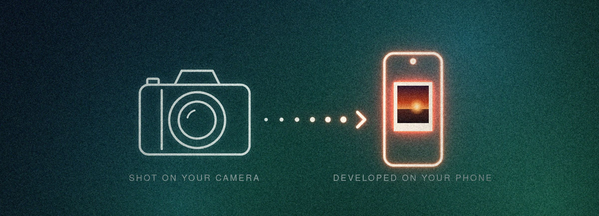
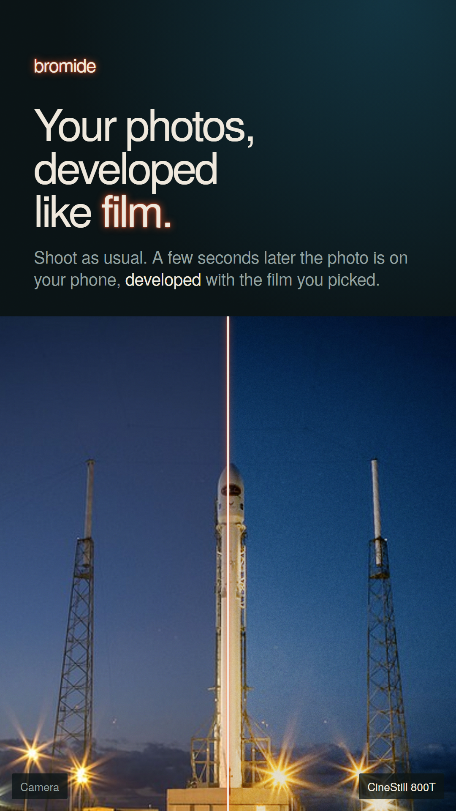
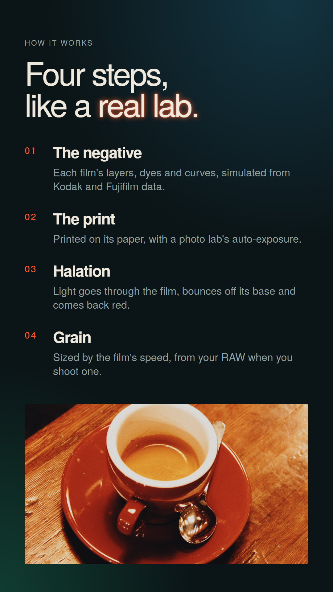
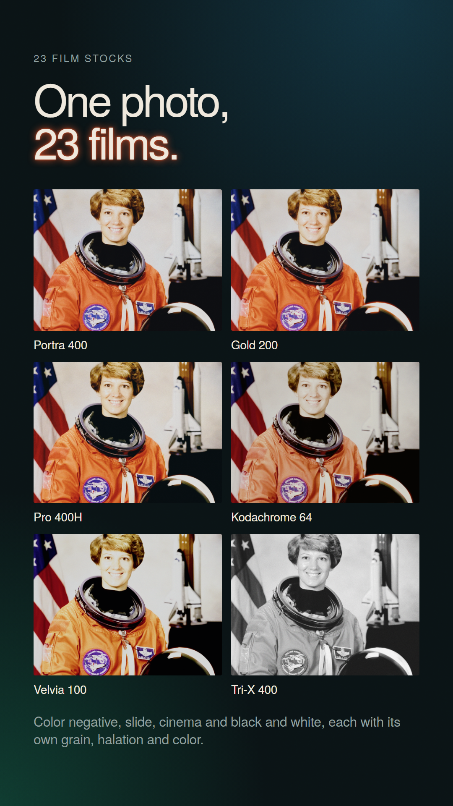
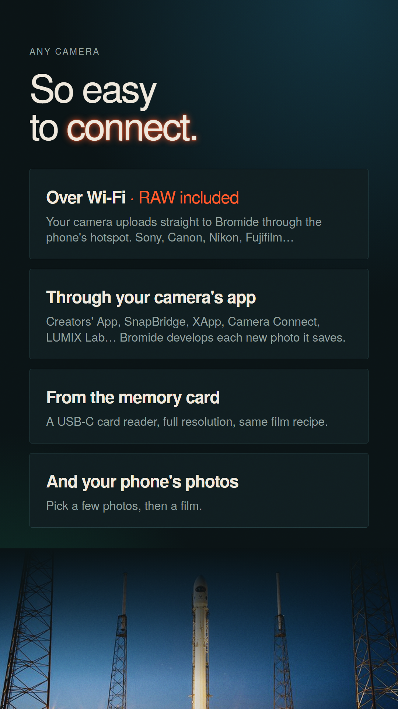

# Bromide

**Real film emulation for your camera, developed on your phone.**

Shoot with your camera like you always do. Every photo lands on your phone
developed, as if it had been shot on film: the colors of a real negative and
print, the grain, the red glow of halation around lights. No presets to stack,
no editing, no laptop.

## Not a filter: a film lab

A filter paints a look on top of a finished photo. Bromide runs your photo
through a simulation of what film does to light:

1. **The negative.** Each stock's color comes from [spektrafilm](https://github.com/andreavolpato/spektrafilm),
   a spectral simulation built from Kodak and Fujifilm datasheets: the spectral
   sensitivity and density curves of each layer, coupler effects, and the paper
   the negative is printed on.
2. **The print.** A lab auto-print step sets exposure the way a photo lab's
   printer would.
3. **Halation.** Bright light goes through the emulsion, bounces off the film
   base and comes back through the red layer. Its strength follows each stock's
   anti-halation layer: CineStill 800T (Vision3 500T without it) glows red
   around lights, Portra barely does.
4. **Grain**, sized by the film's speed and the size of the photo.

From a **RAW** file, all of this runs on the camera's full sensor data, decoded
on the phone, with exposure matched to the camera's own JPEG so your metering is
respected.

## Straight from your camera

Bromide listens to all your cameras at once, any brand:

| How | What you need | |
|---|---|---|
| **Over Wi-Fi (FTP)** | A camera with FTP upload (Sony a7 IV, a7S III, a1, Canon R5, Nikon Z8/Z9, Fujifilm GFX100 II…) and your phone's hotspot | Fastest, RAW included |
| **Through the camera maker's app** | Creators' App, Camera Connect, SnapBridge, XApp, LUMIX Lab, OM Image Share, GR WORLD, Leica FOTOS | Most cameras with Wi-Fi or Bluetooth |
| **From the memory card** | A USB-C card reader | Full resolution, any camera |
| **Phone photos** | Nothing | Pick photos, pick a film |

The first time you open Bromide, a setup guide asks what you shoot with and
walks you through connecting it, checking each step as you go.

## Films

23 stocks, each with its own grain, halation, exposure, color, warmth/tint and
lab auto-print settings (like a camera's picture profile):

- **Color negative:** Kodak Portra 160/400/800, Gold 200, Ultramax 400, Ektar 100 · Fujifilm C200, Superia X-Tra 400, Pro 400H
- **Cinema:** Kodak Vision3 250D, 500T, CineStill 800T
- **Slide:** Fujifilm Provia 100F, Velvia 100 · Kodak Ektachrome 100, Kodachrome 64
- **Black & white:** Kodak Tri-X 400, T-Max 100 · Ilford HP5 Plus, Delta 3200, Pan F Plus 50, SFX 200 · Fujifilm Acros 100 II

Every film is previewed on your own last photo.

## Private by design

No account, no ads, no analytics, no internet connection. Photos travel from
your camera to your phone over your own hotspot or cable, and never leave the
phone. The originals are never modified. See [PRIVACY.md](PRIVACY.md).

## Get it

- **Google Play:** coming soon. Buying it there is the way to support the project.
- **Latest test build:** [GitHub releases](https://github.com/adhdmaxxing/Bromide/releases/latest)
  (`Bromide.apk`, rebuilt on every commit, Android 10+).

## Using it

- Developed photos go to `Pictures/Bromide` (phone photos to `Pictures/Bromide/Phone`).
- **Several cameras:** Bromide tells them apart by EXIF brand and model. Each can
  have its own film, or follow the one picked on the home screen.
- **Camera app link:** Bromide only picks up new photos whose EXIF make matches
  one of your cameras; the phone's own photos and screenshots are left alone. Set
  the app to transfer the original size (many default to 2 MP).
- **FTP:** port 2121, passive mode, user `film`, and the password the setup guide
  shows (generated for your first FTP camera; see Settings → FTP connection).
  Bromide only accepts connections from local networks.
  Tip: one FTP profile per film on the camera, with the
  film's code as user name (`portra400`, `gold200`, `cinestill800t`…), lets you
  switch film from the camera menu.
- **Full resolution later:** phone copies are 2048 px by default and store their
  recipe in EXIF. **Settings → Develop from a memory card** re-develops the
  originals at full size with exactly the same look (or `tools/bromide.py redo`
  on a computer).

## How it's built

- `app/src/main/java/com/bromide/engine/` — the film engine and FTP server, plain
  Java with no Android dependencies, unit-tested on the JVM.
- `app/src/main/java/com/bromide/app/` — the Android app (Kotlin, Jetpack Compose).
- `app/src/main/cpp/` — RAW decoding through [LibRaw](https://www.libraw.org/) (vendored, CDDL-1.0).
- `tools/` — the Python reference implementation, LUT bake scripts, and the
  generators for the banner, icon and store images (`tools/store/render.sh`
  renders the screenshots through the real engine).

Each color stock's response is baked from the full spektrafilm simulation into a
65³ LUT (ΔE₀₀ ≈ 0.25 on average against the simulation), fast enough for a
phone. Black & white stocks use Bromide's own negative-and-paper model
(`tools/bake_bw.py`), since spektrafilm has no B&W data yet.

**Build:** `./gradlew assembleDebug` (Android SDK + NDK). GitHub Actions builds
and tests every push; tagging `v*` builds the signed Play bundle
(`.github/workflows/release.yml`).

**Status:** v0.5, in testing. From JPEGs, highlights are already compressed by
the camera, so halation is weaker than from RAW.
[Issues and camera reports](https://github.com/adhdmaxxing/Bromide/issues) welcome,
especially "it works with my camera X".

## License

Bromide is free software under the GPLv3 (see `LICENSE`): it implements
spektrafilm's methods. Film modeling powered by spektrafilm. The baked LUTs in
`app/src/main/assets/luts/` are © Andrea Volpato, CC BY-SA 4.0 (see
`LUT_LICENSE.txt` and `CHANGELOG.txt` there). LibRaw is used under CDDL-1.0;
the typeface is TeX Gyre Heros (GUST Font License).

The GPL covers the code, not the name: "Bromide" and its logo aren't licensed
for other apps, so forks need their own name and icon (see
[TRADEMARKS.md](TRADEMARKS.md)).

Film names are trademarks of their respective owners. Bromide is not affiliated
with Kodak, Fujifilm, Ilford or CineStill.
